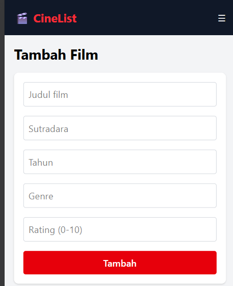
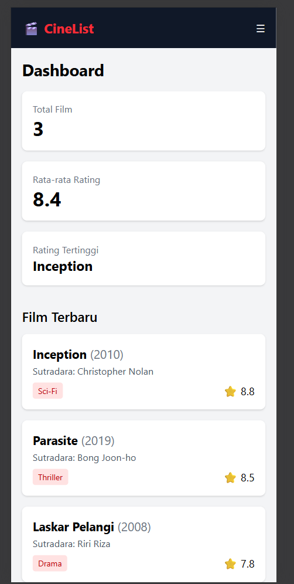
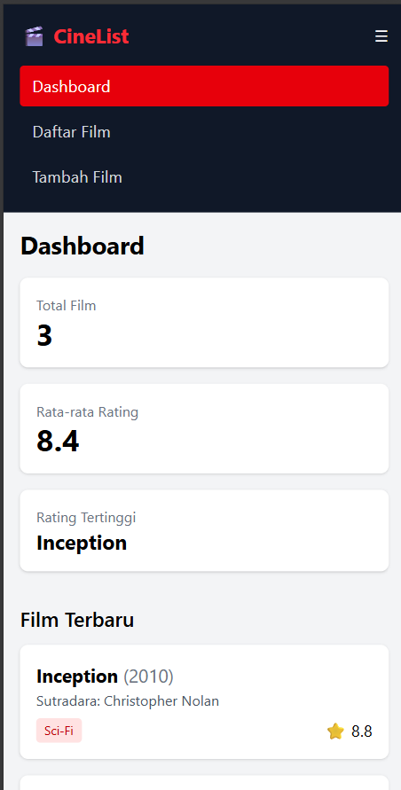
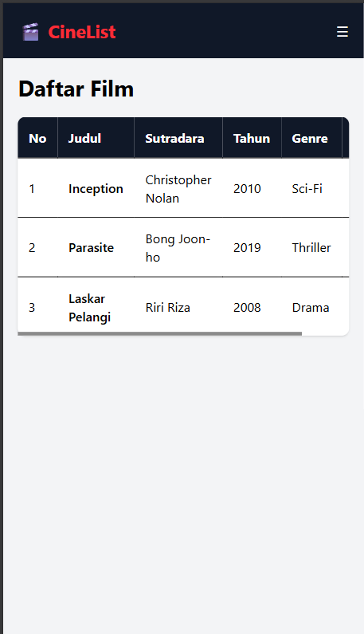
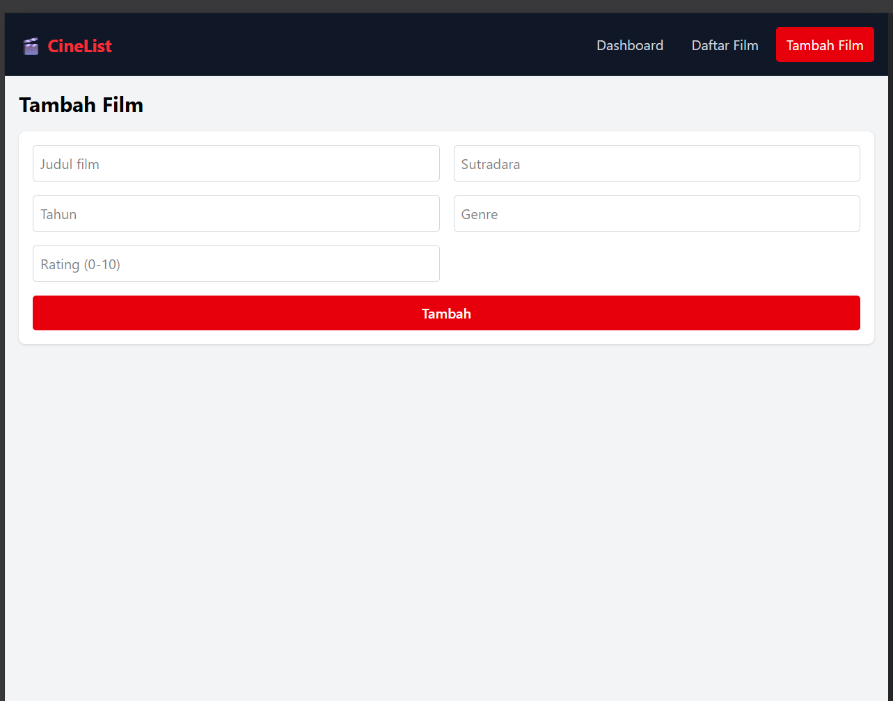
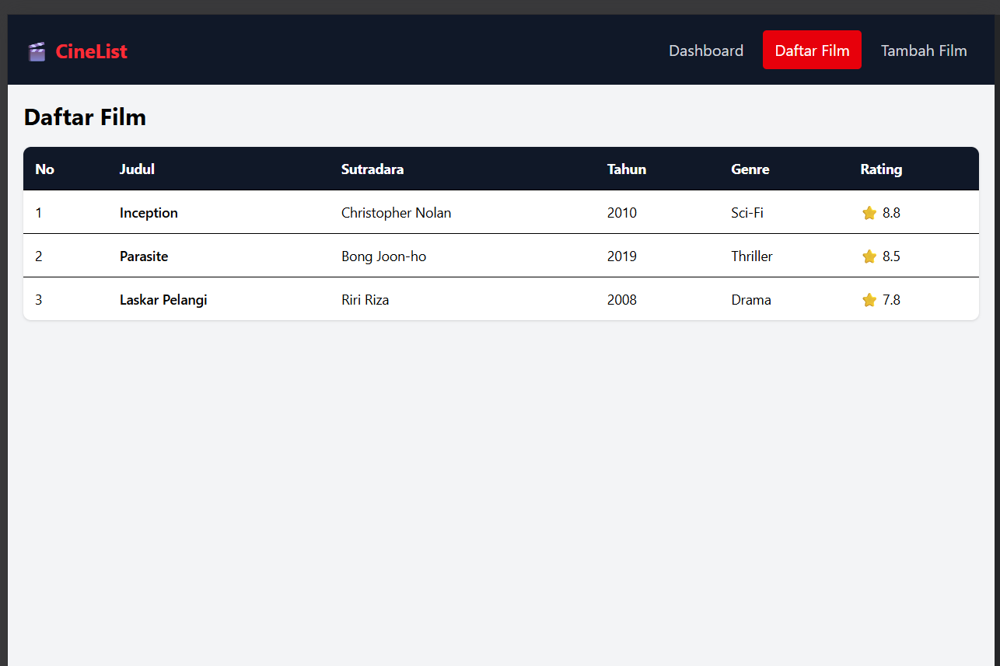
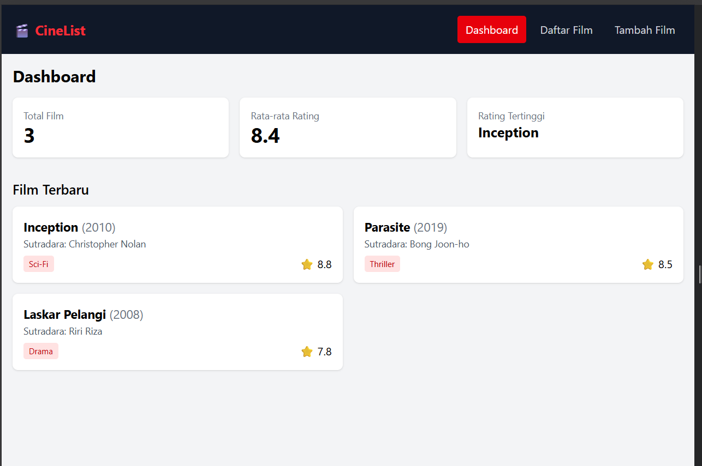

<!-- @format -->

# CineList (film-frontend)

Aplikasi katalog film berbasis React + Vite + Tailwind CSS.
Proyek ini dikembangkan bertahap sampai Pekan 14 menjadi aplikasi fullstack.

## Halaman

- Dashboard (ringkasan + grid kartu)
- Daftar Film (tabel)
- Tambah Film (form)

## Screenshot

### Desktop

▐

### web

## Alasan memilih Tailwind CSS

Saya memilih Tailwind CSS karena aplikasi CineList berfokus pada tampilan kartu dan tabel yang perlu disesuaikan desainnya (tema film). Tailwind berbasis utility class sehingga styling bisa dilakukan langsung di JSX tanpa file CSS terpisah, cocok dengan arsitektur component React. Prefix responsif seperti sm:, md:, dan lg: memudahkan layout menyesuaikan mobile dan desktop. Berbeda dengan Bootstrap yang tampilannya sudah jadi dan cenderung seragam, Tailwind memberi kebebasan desain, dan hanya class yang dipakai yang masuk ke build akhir.
